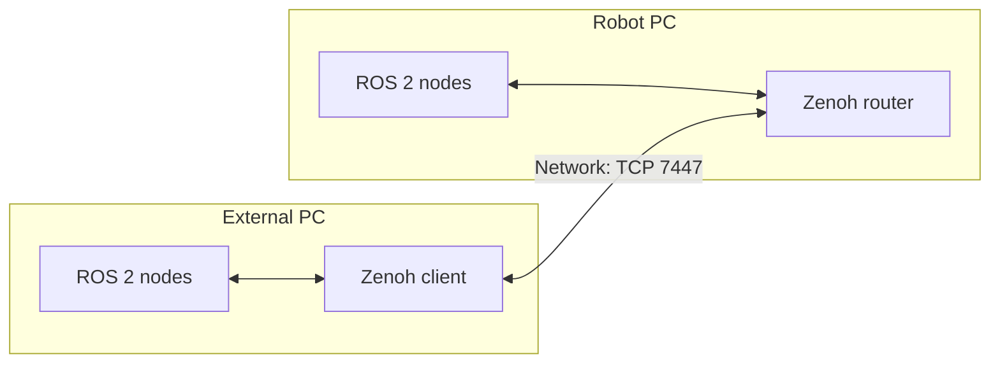

import SectionCard from '@site/src/components/SectionCard';

# External ROS 2 Communication

This guide explains how to connect an external PC to the AI Worker ROS 2 network using Zenoh.

<SectionCard>

## 1. How It Works

By default, the robot's ROS 2 nodes use the local Zenoh router. To communicate from another PC, configure the external ROS 2 environment to connect to the robot's router over the network.



The Zenoh router must be running on the robot, and its endpoint must be reachable from the external PC.

</SectionCard>

<SectionCard>

## 2. Prepare the External PC

1. Connect the robot and external PC to the [same network](/docs/systems/aiworker/quick_start_guide/bringup#1-network-connection).
2. Start the robot's Zenoh daemon using the [Bringup Guide](/docs/systems/aiworker/quick_start_guide/bringup#3-start-the-zenoh-daemon).
3. Prepare a compatible ROS 2 environment on the external PC. AI Worker uses ROS 2 Jazzy. You can use your existing ROS 2 environment or an AI Worker container on the external PC.

In an existing Ubuntu ROS 2 Jazzy environment, install `rmw_zenoh_cpp` if it is not already installed:

```bash
sudo apt update
sudo apt install ros-jazzy-rmw-zenoh-cpp
```

For other environments or installation methods, see the [rmw_zenoh installation guide](https://github.com/ros2/rmw_zenoh/tree/jazzy#installation).

:::note
To use AI Worker-specific interfaces, install or build the matching message and interface packages in the external ROS 2 environment as well.
:::

</SectionCard>

<SectionCard>

## 3. Find the Robot IP Address

Use the robot's IP address on the network shared with the external PC. You can find it using either method below.

### Option 1: Resolve the hostname

Replace `SNPR48A0000` with the serial number printed on the robot, then run this command on the external PC:

```bash
ping -c 1 ffw-SNPR48A0000.local
```

Use the IP address shown in the response.

### Option 2: Check the robot PC

Connect to the robot using [SSH](/docs/systems/aiworker/quick_start_guide/in_depth_guide/robot_pc_access), then run:

```bash
hostname -I
```

Choose the address on the same network as the external PC.

</SectionCard>

<SectionCard>

## 4. Configure the ROS 2 Environment

In each external PC terminal that will run ROS 2 commands or nodes, source the ROS 2 environment and configure Zenoh. If your workspace contains additional packages, source its setup file after the ROS 2 setup file.

```bash
source /opt/ros/jazzy/setup.bash
export RMW_IMPLEMENTATION=rmw_zenoh_cpp
export ROS_DOMAIN_ID=30
export ZENOH_CONFIG_OVERRIDE='transport/shared_memory/enabled=true;mode="client";connect/endpoints=["tcp/192.168.6.2:7447"]'
```

Replace `192.168.6.2` with the robot IP address found in the previous step. `30` is the default ROS domain used by the AI Worker services; if your robot uses a different domain, use that value instead.

:::note
These settings apply to the current terminal. Set them in each terminal where you run ROS 2 commands or nodes.
:::

</SectionCard>

<SectionCard>

## 5. Verify the Connection

Stop any ROS 2 daemon started with an earlier configuration, then check that the robot's nodes and topics are visible:

```bash
ros2 daemon stop
ros2 node list
ros2 topic list
ros2 topic echo /joint_states
```

The last command should show joint state messages while the robot is publishing them. Press `Ctrl+C` to stop it.

If nodes or messages do not appear, check that:

- The Zenoh daemon is running on the robot.
- The robot and external PC can reach each other on the network, including TCP port `7447`.
- `ZENOH_CONFIG_OVERRIDE` uses the robot's current IP address.
- The external PC uses `rmw_zenoh_cpp` and the same `ROS_DOMAIN_ID` as the robot.
- The robot is publishing the topic you are checking.

</SectionCard>
