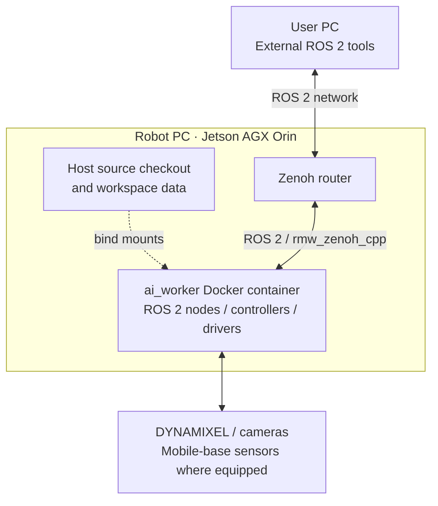
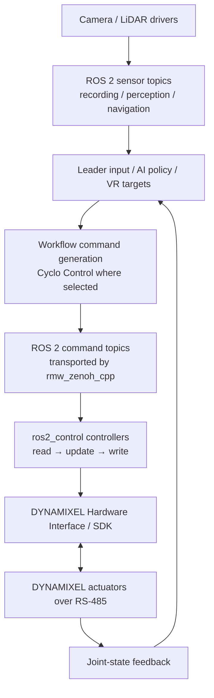

import Tabs from '@theme/Tabs';
import TabItem from '@theme/TabItem';

# Software Architecture

This guide maps the AI Worker software environment: the robot PC, SSD storage, source repositories, Docker containers, startup services, and ROS 2 communication and control.


## System Overview

<div id="system-architecture" />

AI Worker runs its ROS 2 software in the `ai_worker` Docker container on the robot PC. The container uses host-mounted source and workspace directories, runs the robot drivers and controllers, and exchanges commands and state through ROS 2 with Zenoh RMW. An external PC can join that ROS 2 network for operation and visualization.



## Host Environment

The **host OS** runs on the Jetson. The **container OS and ROS workspace** belong to each Docker image. Keep these environments separate when checking versions or installing development dependencies.

<Tabs groupId="aiworker-architecture-models" defaultValue="sg2-bg2">
<TabItem value="sg2-bg2" label="FFW-SG2 / FFW-BG2">

| Host component | SG2 / BG2 environment |
| --- | --- |
| JetPack | 6.2 |
| Jetson Linux | 36.4.3 |
| Host OS | Ubuntu 22.04-based root filesystem |
| CUDA included with JetPack | 12.6 |

</TabItem>
<TabItem value="f1-f2" label="FFW-F1 / FFW-F2">

| Host component | F1 / F2 environment |
| --- | --- |
| JetPack | 7.2.1 |
| Jetson Linux | 39.2.1 |
| Host OS | Ubuntu 24.04-based root filesystem |
| CUDA included with JetPack | 13.2.2 |

</TabItem>
</Tabs>

## Storage & Directory Layout

### SSD and Docker Storage

The robot's SSD is mounted at `/mnt/ssd` using its UUID in `/etc/fstab`. Docker's `data-root` is set to `/mnt/ssd/docker` in `/etc/docker/daemon.json`.

These storage relationships serve different purposes:

| Relationship | Reference paths | Purpose |
| --- | --- | --- |
| SSD filesystem mount | SSD device → `/mnt/ssd` | Makes the SSD filesystem available to the host |
| Docker data directory | `/mnt/ssd/docker` | Docker-managed image and container storage |
| Host repository bind mounts | `/mnt/ssd/ai_worker` → `~/ai_worker`<br />`/mnt/ssd/cyclo_intelligence` → `~/cyclo_intelligence` | Makes SSD-backed repositories available in the home directory |

### Host Directory Map

The following map shows the robot's repository locations and their host bind mounts.

```text
/mnt/ssd/
├── ai_worker/                     AI Worker repository
└── cyclo_intelligence/            Cyclo Intelligence repository

~/
├── ai_worker/                     Bind mount of the SSD repository
└── cyclo_intelligence/            Bind mount of the SSD repository
```

### Container Volume Map

Paths below are resolved relative to the host checkouts shown above. `~` denotes the account that owns the checkout.

| Host path | Container path |
| --- | --- |
| `~/ai_worker` | `/root/ros2_ws/src/ai_worker` |
| `~/ai_worker/docker/workspace` | `/workspace` |
| `~/cyclo_intelligence` | `/root/ros2_ws/src/cyclo_intelligence` |
| `~/cyclo_intelligence/docker/workspace` | `/workspace` |

The two `/workspace` paths belong to different host directories. A file in the `ai_worker` workspace is not automatically in the Cyclo Intelligence workspace. Host-backed data remains when a container is recreated as long as the host files are retained; files stored only in a container's writable layer do not survive its removal.

<details>
<summary>Inspect mounts and data locations</summary>

On the robot host:

```bash
lsblk -f
findmnt /mnt/ssd
findmnt -T "$HOME/ai_worker"
findmnt -T "$HOME/cyclo_intelligence"
docker info --format '{{.DockerRootDir}}'
docker inspect --format '{{.Name}} {{json .Mounts}}' ai_worker cyclo_intelligence
```

For the complete device, display, ZED, configuration, and SDK mounts, inspect the reviewed [robot Compose file](https://github.com/ROBOTIS-GIT/ai_worker/blob/7c6605c6f006e840566c8db4fecaddda47e9a786/docker/docker-compose.yml) and [learning Compose file](https://github.com/ROBOTIS-GIT/cyclo_intelligence/blob/11800ba49ff2f52342ba520138759a9e8bf56153/docker/docker-compose.yml).

</details>

## Containers & Services

### Container Inventory

| Container | Function |
| --- | --- |
| `ai_worker` | Robot ROS workspace, hardware drivers, and robot/leader services |
| `cyclo_manager` | Management API and Docker/agent coordination |
| `cyclo_manager_ui` | Management web UI |
| `zenoh_daemon` | Zenoh router; Compose service name is `rmw_zenoh` |
| `novnc-server` | Optional remote desktop and GUI tools |
| `cyclo_intelligence` | Imitation learning application |

### Management and Application Endpoints

| Endpoint | Reference port / path | Used for |
| --- | --- | --- |
| SSH | TCP `22` | Robot-host terminal |
| Cyclo Manager UI / API | TCP `3000` / `8081` | Browser operation and API |
| Cyclo Intelligence UI | TCP `7080` | Imitation learning web UI |
| noVNC | TCP `8090` | Optional GUI tools |
| Zenoh router | TCP `7447` in the external-PC connection example | Cross-host ROS communication |
| Container/host agents | Unix sockets under `/var/run/robotis/agent_sockets` | Local management; not a separate browser port |

## Control Flow

### Control Architecture

The following diagram shows the AI Worker ROS 2 control structure. The controller update rate is configured at 100 Hz; mobile-base components apply to mobile models.


#### Why `ros2_control`?

`ros2_control` separates controllers from hardware drivers, manages command/state interfaces, and provides the controller lifecycle used by the robot launch files. The configured controllers and their joint lists come from the selected model profile.

### Motion Execution Pipeline



AI Worker controller profiles configure a **100 Hz update rate**. That is a configuration target, not a measurement of timing on every robot. The ROS middleware transports messages; the controller loop and hardware interface handle joint execution.

#### Step-by-Step

1. A leader, AI policy, or VR workflow produces commands for the selected robot.
2. ROS 2 transports command messages through the configured RMW and Zenoh network.
3. The selected controllers consume their command interfaces in the `read → update → write` loop.
4. The hardware interface and SDK exchange commands and state with the actuators.
5. Joint states and sensor topics return to the operation, visualization, and recording workflows.

<div id="development-reference" />

### Controller Configuration & Joint Mapping

The reviewed follower launch remaps the standard trajectory inputs to these topic names. The two arms below include the standard one-joint grippers; optional hands use their matching configuration. Mobile-base control applies to SG2/F2.

<div className="aiworker-controller-table">

| Controller | Role | Reference topic |
| --- | --- | --- |
| `arm_l_controller` | Left arm and standard gripper | `/leader/joint_trajectory_command_broadcaster_left/joint_trajectory` |
| `arm_r_controller` | Right arm and standard gripper | `/leader/joint_trajectory_command_broadcaster_right/joint_trajectory` |
| `head_controller` | Head pan/tilt | `/leader/joystick_controller_left/joint_trajectory` |
| `lift_controller` | Vertical lift | `/leader/joystick_controller_right/joint_trajectory` |
| `joint_state_broadcaster` | Joint state feedback | `/joint_states` |
| `swerve_drive_controller` | SG2/F2 mobile base | `/cmd_vel` in the operation workflow |

</div>

<div id="controller-yaml-example-link" />

#### Controller YAML Example

<details>
<summary>Minimal controller-manager and left-arm configuration</summary>

This is an illustrative extract with a single `/**` parameter scope. It omits other controllers and model-specific parameters; use the complete source profile for deployment.

```yaml
/**:
  controller_manager:
    ros__parameters:
      use_sim_time: False
      update_rate: 100  # Hz

      arm_l_controller:
        type: joint_trajectory_controller/JointTrajectoryController

      arm_r_controller:
        type: joint_trajectory_controller/JointTrajectoryController

      head_controller:
        type: joint_trajectory_controller/JointTrajectoryController

      lift_controller:
        type: joint_trajectory_controller/JointTrajectoryController

      joint_state_broadcaster:
        type: joint_state_broadcaster/JointStateBroadcaster

      swerve_drive_controller:
        type: ffw_swerve_drive_controller/SwerveDriveController

  arm_l_controller:
    ros__parameters:
      joints:
        - arm_l_joint1
        - arm_l_joint2
        - arm_l_joint3
        - arm_l_joint4
        - arm_l_joint5
        - arm_l_joint6
        - arm_l_joint7
        - gripper_l_joint1
      command_interfaces:
        - position
      state_interfaces:
        - position
        - velocity
      allow_nonzero_velocity_at_trajectory_end: true
```

</details>

### Debugging & Safety

#### Debugging & Visualization Tools

| Tool / Topic | Description |
| --- | --- |
| `ros2 control list_controllers` | List loaded controllers and their status |
| `/joint_states` | Real-time joint position and velocity feedback |
| RViz2 | 3D view of robot model (URDF), TF, and movement |

#### Safety & Fault Handling

Joint limits, controller constraints, and hardware communication error handling depend on the selected robot configuration and software version. These mechanisms do not replace the robot's emergency stop or the operating precautions in [Setup Hardware](/docs/systems/aiworker/quick_start_guide/setup_hardware#remote-e-stop-usage).

## Middleware

<div className="zenoh-intro">
  
  <div className="zenoh-intro__text"><strong>AI Worker uses ROS 2 Jazzy with Zenoh RMW</strong> for communication between robot-side nodes, Docker containers, and external PCs. ROS 2 provides the application interfaces; <code>rmw_zenoh_cpp</code> and the router provide the configured communication layer.</div>
</div>

### What is rmw_zenoh?

`rmw_zenoh` is the ROS 2 RMW (ROS Middleware) implementation for Zenoh. The implementation package is `rmw_zenoh_cpp`, and it maps the ROS 2 middleware API onto Zenoh APIs. Existing ROS 2 publishers, subscribers, services, clients, parameters, and command-line tools can keep using normal ROS 2 interfaces while Zenoh handles discovery and transport.

Zenoh is a pub/sub/query protocol designed to move data efficiently across local processes, robot networks, edge computers, and cloud systems. For AI Worker, this means the robot control software can use normal ROS 2 topics while Zenoh provides a lightweight communication layer that is easier to route across containers and hosts than multicast-heavy DDS discovery.

### Main Components

| Component | Role |
| --- | --- |
| `rmw_zenoh_cpp` | ROS 2 RMW implementation selected by `RMW_IMPLEMENTATION=rmw_zenoh_cpp`. |
| `rmw_zenohd` | Zenoh router executable packaged with `rmw_zenoh_cpp`. It provides discovery information and host-to-host routing. |
| Zenoh session | Communication session used internally by ROS 2 contexts. Publishers, subscribers, services, and clients share the session. |
| Zenoh router configuration | Controls how routers listen, connect, and bridge communication between containers, the robot, and remote PCs. |

### How Communication Works

- ROS 2 nodes continue to publish and subscribe to normal topics such as `/joint_states`, `/tf`, or controller command topics.
- `rmw_zenoh_cpp` converts the ROS 2 middleware calls into Zenoh operations.
- A local Zenoh router is normally started so nodes can discover each other.
- On the same host, message data can use direct peer-to-peer paths instead of forcing every sample through the router.
- Across multiple hosts, configure the external PC container as a Zenoh client connected to the robot's Zenoh router endpoint.

### External PC Control

<details>
<summary>Connect an external ROS 2 container to the robot's Zenoh router</summary>

To control AI Worker from an external PC, set up the AI Worker Docker container on the external PC. Then connect the container's Zenoh client to the Zenoh router running on the robot.

Inside the external PC's AI Worker container, set the following environment variable:

```bash
export ZENOH_CONFIG_OVERRIDE='transport/shared_memory/enabled=true;mode="client";connect/endpoints=["tcp/robot_ip:7447"]'
```

Replace `robot_ip` with the real IP address of the AI Worker robot. Use the robot's Wi-Fi IP address when both devices are connected over Wi-Fi, or use the robot's LAN IP address when the external PC is connected through Ethernet.

:::info[Find the robot IP address]
Replace `SNPR48A0000` with the serial number printed on the back of the robot body.

**Option 1: Resolve the mDNS hostname**

AI Worker advertises itself as `ffw-SNPR48A0000.local`. From your external PC, run:

```bash
ping -c 1 ffw-SNPR48A0000.local
```

Use the IP address shown in the response (for example `192.168.6.2`).

**Option 2: Check the IP on the robot**

SSH into the robot and run:

```bash
ssh robotis@ffw-SNPR48A0000.local
hostname -I
```

Use the address on the same network as your external PC (Wi-Fi or LAN, depending on how you connected).

For connection setup details, see [Bringup](/docs/systems/aiworker/quick_start_guide/bringup#accessing-the-robot-pc-via-ssh).
:::

For example, if the robot's IP address is `192.168.0.42`:

```bash
export ZENOH_CONFIG_OVERRIDE='transport/shared_memory/enabled=true;mode="client";connect/endpoints=["tcp/192.168.0.42:7447"]'
```

The AI Worker Docker image enables Zenoh RMW by default. You can check or manually set it with:

```bash
export RMW_IMPLEMENTATION=rmw_zenoh_cpp
```

Keep `ROS_DOMAIN_ID` consistent across terminals and containers when the AI Worker environment expects a specific ROS domain. Even though Zenoh does not rely on DDS multicast discovery, the ROS 2 process environment should remain consistent across the robot-side stack.

</details>

#### Quick Checks

Use these commands inside the AI Worker container to confirm that Zenoh RMW is active and that the ROS graph is visible:

```bash
echo $RMW_IMPLEMENTATION
echo $ZENOH_CONFIG_OVERRIDE
ros2 node list
ros2 topic list
ros2 topic echo /joint_states
```

If topics appear but messages are not flowing, check that:

- `ZENOH_CONFIG_OVERRIDE` uses the robot's real IP address.
- The robot and external PC are on the same reachable network.
- Port `7447` is reachable from the external PC.
- The AI Worker container is running with the expected network configuration.
- Old ROS 2 daemon state has been stopped with `ros2 daemon stop`.

### Using rmw_fastrtps_cpp

<details>
<summary>Reference procedure for switching ROS middleware</summary>

AI Worker uses Zenoh RMW by default. If you want to use Fast DDS instead, update `RMW_IMPLEMENTATION` in `~/.bashrc` inside every container that runs ROS 2 nodes (the robot runtime, learning services, and any other ROS 2 participants).

Connect to the robot host over SSH, then enter the robot container.

```bash
ssh robotis@ffw-snpr48a0000.local
./ai_worker/docker/container.sh enter
```

Open the `~/.bashrc` file with nano.
```bash
nano ~/.bashrc
```

Find the line that says `export RMW_IMPLEMENTATION=rmw_zenoh_cpp` and change it to `export RMW_IMPLEMENTATION=rmw_fastrtps_cpp`.

Save and exit the file.(ctrl + x, y, enter)

Restart the container from the **host terminal**:

```bash
exit
docker restart ai_worker
```

If you use cyclo intelligence, you also need to update `RMW_IMPLEMENTATION` in `~/.bashrc` inside the cyclo intelligence container.

</details>
